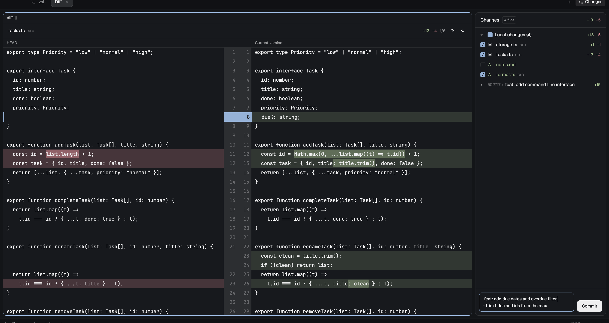
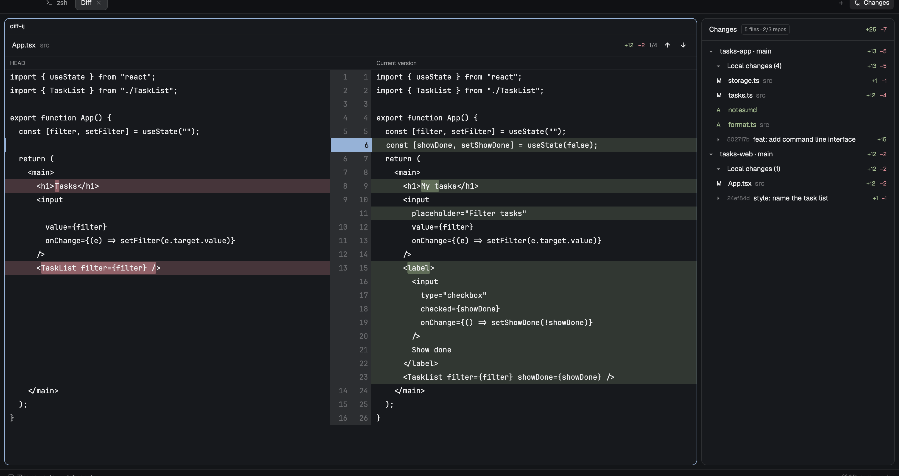

# herdr-changes-diff

A [Herdr](https://herdr.dev) mod: an IntelliJ-style Changes panel and a
side-by-side Diff tab.

- Local changes and unpushed commits, grouped and foldable.
- A commit box that commits only the files you leave checked, with a
  multi-line message (`⌘Enter` to commit).
- A folder that holds several repos shows one group per repo.
- The Diff walks through the changes with `↑`/`↓` or `F7`/`Shift+F7`, and
  long lines scroll sideways.



A folder that holds several repos:



## Install

Ask your agent in Herdr:

> Read ~/.config/herdr-app/AGENTS.md, then add this mod: herdr.dev/mods/ausema/herdr-changes-diff

Then put `changes-ij` in your layout's Changes panel in place of `changes`.

It runs `git` in the repo you are working in (read-only, except `git add`
and `git commit` of the checked files when you press Commit), and `find` to
look for repos one level down in a folder that isn't one. No network calls.

## Develop

```sh
for m in changes-ij diff-ij; do (cd mods/$m && for t in test/*.test.js; do node --test "$t"; done); done
```

See [RECIPE.md](RECIPE.md) for how it looks and behaves.
