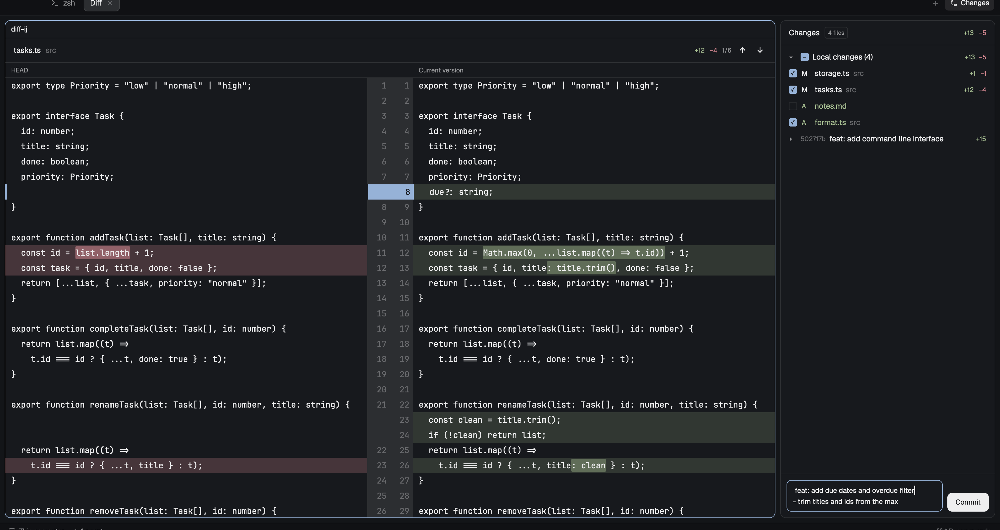

# Changes + Diff (IntelliJ style)

A Changes panel like IntelliJ's Commit window: a flat list of the files you
changed and, under it, one foldable group per unpushed commit. Clicking a file
opens it in a **Diff** tab as a side-by-side diff of the whole file, with
`↑`/`↓` buttons (and `F7`/`Shift+F7`) to jump between changes and the current
change marked, so a big file is easy to walk through.

## What you see

### Changes panel (`changes-ij`)

- **Header**: 42 px, 14 px side padding, a 1 px `border` line under it.
  `Changes` in semibold, a badge `N files` (10 px text, `muted`, 1 px `border`
  outline rounded 4 px), then right-aligned `+add` in `ansi2` and `−del` in
  `ansi1` (11 px), summed over the uncommitted files.
- **List**: scrolls vertically, 6 px padding, rows 28 px tall, rounded 7 px.
  - `▾ Local changes (N)` group (semibold title, `muted` arrow, its `+`/`−`):
    one row per uncommitted file, untracked ones included; `No uncommitted
    changes` in `dim` when empty.
  - Then one group per unpushed commit, newest first: arrow, short sha in
    `dim` 11 px, the subject in semibold, its `+`/`−`. Its files are indented
    14 px.
  - A file row: status letter in a 14 px column (`A` in `ansi2`, `D` and `U`
    in `ansi1`, `M` in `foreground`), the file name (max 260 px, truncated) in
    the same color, then its folder in `dim`, then `+n` / `−m`.
  - The open file's row has the `selected` background; rows get `hover` on
    hover.
- **Commit box** at the bottom: a 1 px `border` line on top, 10 px padding, a
  32 px input `Commit message` (border turns `accent` while typing) and a
  `Commit` button (`solid` / `solid_foreground` when there is a message,
  `raised` / `dim` otherwise; `Committing…` while it runs). Errors show in
  `ansi1` 11 px above it.
- **A folder of several repos** (the folder isn't a repo, its subfolders
  are): one foldable group per repo with something to show, by path,
  titled `repo-name · branch` with its `+`/`−`; its `Local changes` and
  commit groups are nested inside, indented 14 px (an error reading that
  repo shows in `ansi1` instead). The badge reads `N files · shown/total
  repos`; with no repo to show, `No changes in N repositories`. No commit
  box.
- Messages instead of the list: `Not a git repository`, `Loading changes…`,
  `No folder`. Limits shown in `dim` 11 px: `Showing the first 1,000 changed
  files`, `Showing the last 50 unpushed commits`.

### Diff tab (`diff-ij`)

- **Header**: 42 px, 1 px `border` line under it: file name in semibold, its
  folder in `dim`, the commit's short sha in `muted` 11 px when the file came
  from a commit, `Showing the first 5,000 lines` in `blocked` when cut, `+N` in
  `ansi2`, `−N` in `ansi1`, then the change counter `i/total` in `muted` 11 px
  (`–/total` before the first jump; hidden with no changes) and two buttons
  `↑` and `↓` (6 px padding, rounded 4 px, `raised` on hover; `dim` and inert
  with no changes).
- **Labels row**: 26 px, 11 px `muted`: left `HEAD` / right `Current version`;
  `(new file)` on the left for untracked files or a repo without commits;
  `<short>^` / `<short>` for a commit's file.
- **Rows**: in the terminal font (`settings().font_family`, else JetBrains
  Mono) and size, row height `ceil(font_size × 1.8)`. Old file on the left,
  new on the right, and in the middle two line-number columns on `raised`
  (`dim` numbers). The whole file is shown, not only the hunks.
  - Removed / left side of a changed line: `ansi1` at alpha `3d` (~24 %).
  - Added / right side of a changed line: `ansi2` at alpha `2e` (~18 %).
  - In a changed pair, the part that differs (common prefix and suffix
    stripped) gets a rounded 2 px highlight: `ansi1` at `80` / `ansi2` at `66`.
  - Rows of the change you jumped to: a 3 px `accent` bar on their left edge
    and the number columns on `accent` with `accent_foreground` numbers.
  - A gap between hunks is a `⋯` row on `raised`.
- Notices instead of rows (`dim` 12 px): `Select a file in Changes`,
  `Loading diff…`, `Binary file · no text diff`, `Binary file changed`,
  `Empty file`, `Cannot preview this file (binary, too large, or unreadable)`,
  `Cannot show this diff: <git error>`.

## How it behaves

- **Which repo**: the panel follows the focused terminal's folder (also on a
  remote machine); while the Diff tab or another mod has the focus it keeps
  the space's last location. It refreshes every 10 s and on every change the
  folder watch reports (local folders only).
- **Several repos**: when the folder isn't inside a repo, `find <folder>
  -mindepth 2 -maxdepth 2 -name .git` gives the repos one level down,
  loaded 4 at a time. A repo's first call is `git status --branch`; one with
  no changes and level with its upstream (no `[ahead N]`, not `[gone]`)
  stops there and is hidden. The rest load as a single repo does; one still
  with nothing to show is hidden too. No folder watch in this mode: the 10 s
  poll is enough. Clicking a file hands that repo's root to the Diff tab.
- **Groups**: click a group header to fold or unfold it. New unpushed commits
  arrive folded; a group you opened or closed keeps its state. Unpushed means
  `@{upstream}..HEAD`, or commits on no remote branch when there is no
  upstream.
- **Click a file**: selects its row and opens the `Diff` tab of the active
  space (selects it if a tab named `Diff` exists, else creates it focused).
  Clicking the same file again reloads it.
- **Commit**: Enter in the input or the button runs `git add -A` then
  `git commit -m <message>` in the repo root; the message clears on success.
  Not offered for a folder of several repos.
  `Escape` while typing leaves the input.
- **Diff contents**: a local file is diffed against `HEAD` with the whole file
  as context; an untracked file (or any file in a repo with no commits) shows
  the file on disk as all added; a commit's file shows that commit against its
  first parent. A local file reloads when it, `.git/HEAD` or `.git/index`
  change.
- **Jumping between changes**: a change is a run of consecutive added,
  removed or changed rows. `↓` / `F7` goes to the next one, `↑` / `Shift+F7`
  to the previous one, wrapping around at the ends; the change is centered and
  marked. Jumps count from the marked change while it is on screen, otherwise
  from the middle of the view. Opening a file jumps to its first change.
- **Keys** work while the Diff tab has the keyboard: click it, or reach it
  with pane navigation (`"focusable": true`).

## Built from

- Two mods, no layout and no `keys.json`:
  - `mods/changes-ij/`: `main.js` (the panel view), `commits.js` (unpushed
    commits: `git log` / `git show --raw --numstat` args and parsers),
    `repos.js` (a folder of several repos: `find` args, `status --branch`
    parser, the quiet check, bounded parallel loading),
    `location.js` (which folder to follow), `changes.svg`, tests. `mod.json`:
    `"place": "none"`, cloned from Herdr's shipped `changes` 0.1.17.
  - `mods/diff-ij/`: `main.js` (the tab view), `side-by-side.js` (unified diff
    to side-by-side rows, changed span, tab expansion), `source.js` (diff
    source, labels, watch filter, commit args), `navigation.js` (change
    blocks and jumps), tests. `mod.json`: `"place": "none"`,
    `"title": "Diff"`, `"focusable": true`.
- The panel hands the file to the tab with `setShared("diff-ij.target",
  {root, path, on, commit, requested})`; the tab reads `shared("diff-ij.target")`.
- `herdr`: `spaces`, `panes`, `focused`, `exec`, `watchFolder`, `readTextFile`,
  `theme`, `settings`, `run` (`tab.select`, `tab.new {name, mod, focus}`),
  `setShared`/`shared`, `nextCommand`. `gpui-base`: `v_flex`, `h_flex`,
  `Scrollbar`, `Input`/`InputState`, `v_virtual_list`,
  `VirtualListScrollHandle`.
- Programs: `find` (a folder of several repos) and `git` (read-only commands with `--no-optional-locks -c
  core.fsmonitor=false -c diff.autoRefreshIndex=false`, plus `add -A` and
  `commit` from the Commit button). No network.

## Watch out

- The panel only appears where your layout puts it: replace the shipped
  `changes` mod with `changes-ij` in your layout's Changes panel (or open it
  with `mod.open`). `diff-ij` is opened by the panel; you never place it.
- If you rename the mods, change `DIFF_MOD` and both `diff-ij.target` keys
  together. A `Diff` tab left from another diff mod is reused by name: close
  it once.
- Git reads must not write under `.git`, or the folder watch triggers itself
  and refreshes forever.
- The diff list is virtual: every row must have the same height, and the jump
  math uses that height and `VirtualListScrollHandle.offset()`.
- Theme colors are appended a two-digit hex alpha: they must be `#rrggbb`.
- Limits: 1,000 files, 50 unpushed commits, 5,000 diff rows, 4,000 columns
  per line, 400,000 characters of an untracked file.
- The Commit button stages everything (`git add -A`); there is no partial
  staging, revert or editing from the diff.
- Several repos: only one level down is searched; a folder that is itself
  inside a repo (a home folder kept in git) shows that repo instead. A repo
  with no remote lists its commits as unpushed (up to 50), as in a single
  repo.

## Done when

- `herdr-app check mods/changes-ij` and `herdr-app check mods/diff-ij` pass,
  and `node --test` on each file in both `test/` folders passes.
- In a repo with an edited file, an untracked file and an unpushed commit, the
  panel lists the first two under `Local changes` with `M` / `A` and the
  commit as a folded group whose files open with `<short>^` / `<short>` labels.
- Clicking the edited file opens the `Diff` tab with `HEAD` / `Current
  version`, red and green rows, the differing part of changed lines
  highlighted, the counter at `1/N` and the first change marked.
- `↓` / `F7` walks `2/N` … `N/N` and back to `1/N`; `↑` / `Shift+F7` goes the
  other way; a file without changes shows the buttons dimmed.
- In a folder holding a repo with an edited file and a clean one level with
  its upstream, the panel shows only the first, as `name · branch`, the badge
  reads `1 files · 1/2 repos`, there is no commit box, and clicking the file
  opens its diff.
- Saving the file changes the diff without picking it again; typing a message
  and pressing Commit empties `Local changes` and adds a commit group.
